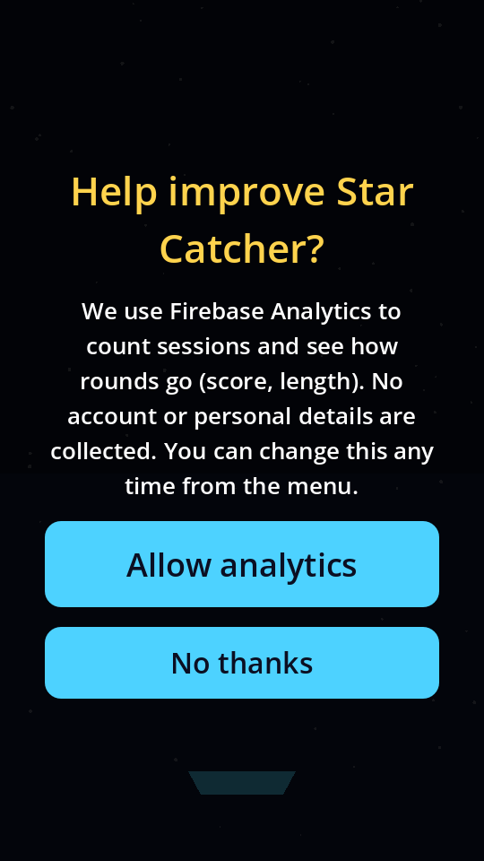
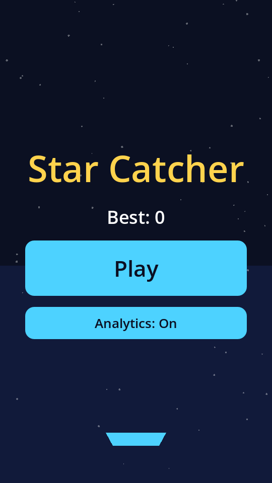
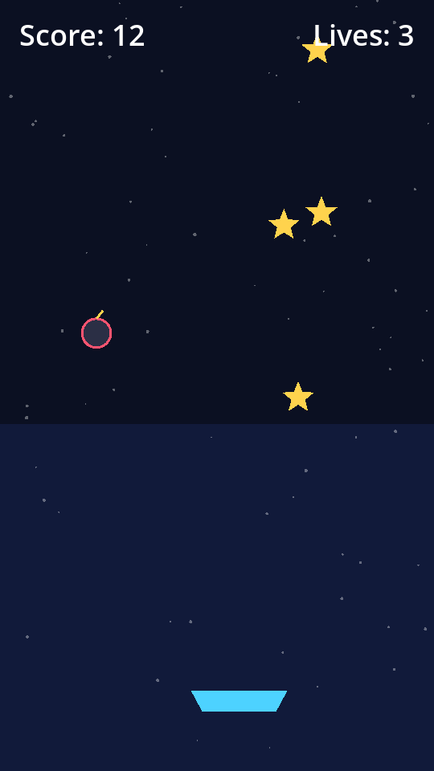
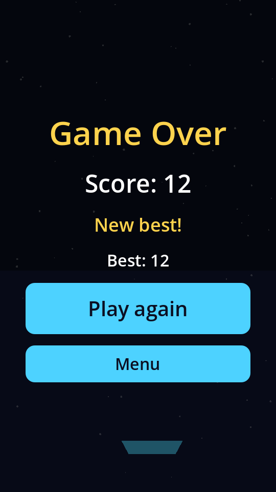

# Star Catcher — Product Teardown

*A product-analysis exercise on a small casual Android game, written as a portfolio piece for a
Product Management internship in Growth and Player Marketing at a mobile games studio.*

**What this is.** Star Catcher is a small casual game built to practise product analysis. It is not a
launched product, it has no players beyond its author, and this document does not claim a target
market. Everything below is about what the code shows and what a first playtest should test.

**How to read the evidence labels.** Every claim carries one:

| Label | Meaning |
|---|---|
| **[FROM CODE]** | Read directly from the source, with a file and line. Line numbers refer to commit `982c2e5`, the version analysed (`git show 982c2e5:scripts/main.gd`). |
| **[FROM CODE · SIMULATED]** | Measured by running the real game code with a simple bot (`tools/measure_baseline.gd`). A bot is not a person; these numbers bound what is possible, they do not describe players. |
| **[FROM PLAYTEST]** | Data from real players. **There is none yet**, so this label appears only where the document says what a playtest should collect. |
| **[HYPOTHESIS]** | A reasoned guess that needs testing. Nothing labelled this way should be quoted as fact. |

**Four terms used throughout.** *Funnel*: the ordered steps a new player passes through, and how many
drop out at each. *D1 / D7 / D30 retention*: the share of players who come back on day 1 / 7 / 30
after first opening the app. *Guardrail metric*: a number that must not get worse while you improve
the main one. *Consent*: the player's yes/no to analytics tracking.

---

## 1. Executive summary

**The game.** A one-thumb portrait arcade game: drag a basket to catch falling stars and dodge bombs;
three lives per round; it speeds up as the score rises. Built in Godot 4.7 for Android, with Firebase
Analytics and a local playtest log.

**Top 3 strengths**
1. **Fast retry loop.** Game over → *Play again* is one tap (`main.gd:27`), and a round can be short: a player
   who never moves is out in a median of 7.7 s. **[FROM CODE · SIMULATED]**
2. **One input, nothing to learn about controls.** Only touch and drag are handled (`game.gd:136-142`).
   **[FROM CODE]**
3. **Built to be measured.** Consent-aware Firebase events, a local funnel log with a share button, a
   report script, 240 automated game checks and 22 Python tests. This is what makes the playtest in Lens E worth running. **[FROM CODE]**

**Top 3 problems**
1. **Nothing explains the game, and the first reward is late.** There is no tutorial or rule text; the
   rule that *missing a star costs a life* (`game.gd:124-126`) is never shown. The first possible catch is
   ~4.2 s after Play, and a player who doesn't move loses their first life at ~4.8 s. **[FROM CODE · SIMULATED]**
   Whether new players actually quit here is **[HYPOTHESIS]**.
2. **Nothing to come back for.** The only hook is the best score. Three milestones are tracked but never
   shown to the player (`main.gd:76-80`), and difficulty stops rising at score 78, about one minute of
   perfect play. **[FROM CODE · SIMULATED]**
3. **The game is silent at the moments that matter.** Losing a life, reaching a milestone and the reason a
   round ended have no message; "New best!" appears for any first score above zero, even for a player who
   never touched the screen (58% of such rounds score at least one star). The first thing the player reads,
   the consent screen, is 38 words with a claim — "No account or personal details are collected" — that
   should be checked before it ships. **[FROM CODE · SIMULATED]**

**The one experiment.** *Guided first round*: a one-line rule prompt plus a first star that arrives in
about 2 s. Because ten friends cannot power an A/B test, it is designed as a **before-and-after pilot with
qualitative feedback** (5 friends on the current build, 5 different friends on the new one) and is
**not** a statistical test; the sample-size maths for a real launch is in Appendix A.

**What is not known.** Anything about real players: fun, difficulty, drop-off, retention. No playtest data
exists yet, and the Firebase and share-log paths have not run on a physical phone (§6).

---

## 2. Game card and player journey

### 2.1 Game card

| Item | Value | How it was inferred |
|---|---|---|
| Genre | Arcade "catcher", endless score-chaser | Mechanics and header comment, `game.gd:1-3`. **[FROM CODE]** |
| Platform | Android phone, portrait, touch | `project.godot` (portrait orientation, 540×960); touch handling `game.gd:136-142`. **[FROM CODE]** Not yet run on a device. |
| Core loop | Drag the basket → catch stars (+1) → dodge bombs → lose a life for each missed star or caught bomb → at 0 lives the round ends → *Play again* | `game.gd:102-129`, `165-172`, `175-189`. **[FROM CODE]** |
| What the player does each minute | Continuous dragging while ~1–2 stars and ~0.2–1 bombs arrive per second (table in Lens B) | Spawn and speed formulas `game.gd:90-99`. **[FROM CODE]** How long a *real* player lasts is unknown. **[HYPOTHESIS]** |
| Session length | No timer or cap; set by the player's skill and choice to replay. Floor: a non-moving player's round lasts 6–15 s. Ceiling: an instant-aim bot was still alive after 10 minutes. | `game.gd` has no round limit; bots in `tools/measure_baseline.gd`. **[FROM CODE · SIMULATED]** |
| Win condition | **None.** There is no level or win state. "New best!" is the only success marker; three milestones (10/25/50 stars) exist but are invisible. | `main.gd:5`, `main.gd:76-80`, `main.gd:92-95`. **[FROM CODE]** |
| Lose condition | Three lives, lost by missing a star or catching a bomb | `game.gd:20`, `124-126`, `165-172`. **[FROM CODE]** |
| Tech stack | Godot 4.7, GDScript, GL Compatibility renderer; Firebase Analytics through the community [godot-x/firebase](https://github.com/godot-x/firebase) plugin; local JSON-lines playtest log; 240 Godot checks + 22 Python tests | `project.godot`, `scripts/`, `tests/`, `tools/`. **[FROM CODE]** |

The game has no "levels", so the brief's `first_level_win` has no equivalent here. This teardown uses
**first star caught** as the first-reward moment and **reaching 10 stars** as the first milestone.

### 2.2 The four screens

| Consent | Menu | Playing | Game over |
|---|---|---|---|
|  |  |  |  |

*Baseline build (commit `982c2e5`). The playtest build adds a disclosure note and a share button
(`screenshots/playtest-consent.png`, `playtest-menu.png`).*

### 2.3 Every step from first launch to first reward, in order

1. **Launch.** The engine's default start-up splash probably appears first; `project.godot` does not change
   it and it has not been observed on a device. **[HYPOTHESIS]**
2. **Consent screen** (`main.gd:34-35`): title, a 30-word explanation, two buttons. **[FROM CODE]**
3. **Tap** *Allow analytics* **or** *No thanks* (`main.gd:30-31`). Either leads to the menu.
4. **Menu:** "Star Catcher", "Best: 0", *Play*, "Analytics: On/Off".
5. **Tap** *Play* (`main.gd:26`, `53-57`). The round starts with "Score: 0" and "Lives: 3".
6. **A near-empty screen for about 4 s.** The first item spawns 0.5 s after Play (`game.gd:68`) at the top
   (`game.gd:82`) and falls at 230 px/s. No text tells the player what to do.
7. **Touch or drag** to move the basket (the player has to discover this).
8. **First star caught** → the "Score" number goes from 0 to 1. This is the first reward; there is no sound,
   animation or message (no audio, tween or particle code exists anywhere in the project).
9. Play continues; each lost life only changes the "Lives" number.
10. **Round ends** at 0 lives → "Game Over", "Score", "Best" and, for any first score above zero, "New best!"
    (`main.gd:92-95`, `109`).
11. **Tap** *Play again* (one tap) or *Menu*.

**First-session counts [FROM CODE]:** 3 screens, 2 button taps before the round starts, 0 tutorial prompts,
38 words on the first screen (title 4, body 30, buttons 4). A returning player (consent already given) needs
1 tap. **Time from tapping Play to the first possible reward: ~4.2 s** (median of 40 simulated rounds; up to 8.0 s
when the first items are bombs) **[FROM CODE · SIMULATED]**.

---

## 3. The five lenses

### Lens A — Onboarding and first session  *(deepest)*

#### A.1 What exists today
See §2.3. In short: **3 screens, 2 button taps, 0 tutorial prompts** from first launch to the first round, with
**no instruction at all**; the player learns by failing. The first reward (a star caught) comes at the earliest
~4.2 s after the second tap. **[FROM CODE]**

The first-minute numbers, from two bots playing the real game code (`tools/measure_baseline.gd`):

```
IDLE player, 300 rounds: a round lasts median 7.7 (min 6.1, max 14.8) s; first life lost at median 4.8 (min 4.2, max 8.6) s
IDLE player: 174 of 300 rounds still caught at least one star by luck (basket starts mid-screen)
INSTANT-AIM player reaches score   1 at median 4.2 (min 4.2, max 8.0) s
```

What they mean in plain language **[FROM CODE · SIMULATED]**:
- **An idle player** (never touches the screen) loses their first life at about 4.8 s and is out in a median of
  7.7 s. If the first rounds of a real newcomer look like this, they see a number tick down three times and the
  screen change to "Game Over" without having done anything.
- **58% of those idle rounds still catch at least one star**, because the basket starts mid-screen and 28% of
  star positions fall inside its reach. Best starts at 0, so `result.score > Save.best_score`
  (`main.gd:92`) is true and the game says **"New best!"** to someone who never moved.
- **The fastest possible player** (instant-aim bot) gets the first reward at ~4.2 s. A real player cannot be
  faster, so **the reward can never arrive sooner than ~4 s after Play** in the current design.

#### A.2 The three steps where a new player is most likely to quit

All three are **[HYPOTHESIS]** — grounded in the code facts above, untested with people. Each lists what in a
playtest would confirm or kill it.

| # | Step | Why a new player might quit here | What would confirm it |
|---|---|---|---|
| 1 | **Consent screen** (step 2) | It is the first screen; it asks for something before the player has seen any game; it is the longest block of text in the whole game (38 words incl. buttons; 75 in the playtest build); and it uses the word "Firebase", which means nothing to most players. | Observation: seconds spent on the screen, whether they read it, whether they hesitate. Log: players with `consent_shown` but no `consent_choice` (drop-off at funnel step 3). |
| 2 | **The first ~4 s of the first round** (step 6) | Nothing on screen says what to do or what the objects are; the first reward cannot come before ~4.2 s; a player who is unsure what to do is already behind. | Observation: "what do I do?" questions, time to first touch. Log: `round_first_star.seconds_in_round` for round 1; share of first rounds with **zero** stars. |
| 3 | **First lives lost and the first Game Over** (steps 9–10) | The rule that missing a star costs a life is never stated; lives drop silently; Game Over gives no cause. A player who does not understand *why* they lost has no reason to try again. | Survey Q3 (can they state how you lose?); log: players who finish round 1 but never start round 2 (funnel step 7). |

#### A.3 The onboarding funnel, defined so it can be measured

Eight steps, recorded in the local playtest log (§4). **Strict**: a player counts at a step only if they also
passed every earlier step. Counts are per install, not per session.

| # | Step (name) | Log event | Definition | What a drop here suggests |
|---|---|---|---|---|
| 1 | `first_launch` | `app_open` with `first_launch=1` | The app opened for the first time | (denominator) |
| 2 | `consent_shown` | `consent_shown` | The consent screen appeared | Crash or quit before the first screen |
| 3 | `consent_answered` | `consent_choice` | Tapped *Allow* or *No thanks* | **The consent screen itself drives people away** |
| 4 | `first_round_started` | `round_start` | Tapped *Play* | Menu not inviting; or consent friction carries over |
| 5 | `first_star_caught` | `round_first_star` | Caught any star, in any round | **Player does not get a first reward / does not understand the game** |
| 6 | `first_round_finished` | `round_end` | A round reached Game Over | Quit mid-round (also see `app_background` with `in_round=1`) |
| 7 | `second_round_started` | `round_start`, `round_number ≥ 2` | Started a second round | **No reason to play again** — the key "was it worth it?" step |
| 8 | `reached_10_stars` | `unlock_milestone`, `id=catcher_10` | Reached 10 stars once | Game too hard, too boring, or the player left before getting good |

**Supporting numbers** the same log gives: seconds to the first star (`round_first_star.seconds_in_round`),
rounds whose first round had zero stars, rounds left unfinished, consent opt-in rate.

**Known blind spots of this funnel**
- The consent screen is measured by the *local* log, which runs even for players who decline Firebase; the
  Firebase dashboard cannot see them at all (so Firebase-only funnels over-state how engaged players are).
- The playtest build adds a 37-word note to the consent screen, which doubles its text and may itself lower
  step 3. Compare with a build without the note if that step matters. **[HYPOTHESIS]**
- Strict ordering means a player who plays a whole round without catching a star is counted as lost at step
  5, even though they reached step 6. That is deliberate: it makes the "never got a reward" group visible.

#### A.4 Recommendation (one)
**Make the first round teach itself.** On a player's first round only: show one line of rule text ("Drag to
move. Catch ★. Missing a ★ or hitting a bomb costs a life.") and make the first item a star that arrives in
about 2 s instead of 4.2 s. This is the change tested in §5. Also considered and not chosen: asking for consent
*after* the first round (better first impression, but it delays Firebase collection and needs a legal check)
and removing the engine splash.

---

### Lens B — Progression and retention

#### B.1 How difficulty, rewards and unlocks change
**Difficulty** rises with score through three formulas (`game.gd:90-99`); every one stops rising by score 78.
**[FROM CODE]**

```
INSTANT-AIM player, 40 rounds: still alive after 10 minutes in 40 of 40; score at that point median 926.0 (min 883.0, max 969.0)
INSTANT-AIM player reaches score  10 at median 13.9 (min 12.1, max 15.9) s
INSTANT-AIM player reaches score  25 at median 28.5 (min 24.9, max 32.1) s
INSTANT-AIM player reaches score  50 at median 47.5 (min 41.4, max 52.6) s
INSTANT-AIM player reaches score  78 at median 63.6 (min 57.7, max 70.3) s
INSTANT-AIM player reaches score 100 at median 78.7 (min 71.7, max 84.3) s
```

| Score | Item speed | One item every | Bombs | Stars/s | Bombs/s |
|---|---|---|---|---|---|
| 0 | 230 px/s | 0.95 s | 15% | 0.89 | 0.16 |
| 10 | 280 px/s | 0.83 s | 19% | 0.98 | 0.23 |
| 25 | 355 px/s | 0.65 s | 25% | 1.15 | 0.38 |
| 48 | 470 px/s | 0.38 s | 34% | 1.73 | 0.90 |
| 63 | 545 px/s | 0.38 s | 40% | 1.58 | 1.05 |
| **78 and above** | **620 px/s** | **0.38 s** | **40%** | **1.58** | **1.05** |

**Rewards:** +1 score per star; a persisted best score; a "New best!" banner; three milestones at 10/25/50
stars that are saved and sent to analytics but **never shown** (`main.gd:5`, `76-80`). **Unlocks:** none.
**Currency:** none. **[FROM CODE]**

#### B.2 Reasons to come back

| Day | Reason to return today | Strength |
|---|---|---|
| **Day 1** | Beat the best score on the menu ("Best: N") | Exists, thin. A single number to beat, with no goal beyond it. **[FROM CODE]** |
| **Day 7** | **Nothing yet.** | No daily goal, streak, event, unlock, social comparison, collection or notification. **[FROM CODE]** |
| **Day 30** | **Nothing yet.** | Same. |

#### B.3 Where it gets grindy, repetitive or too easy
- **Too easy for a skilled player — the whole difficulty curve is exhausted in about a minute.** An instant-aim bot
  reaches score 78 (the last difficulty step) at a median of 63.6 s and stays alive for the full 10 minutes in
  40 of 40 rounds, scoring ~926. After score 78 the game never changes again. **[FROM CODE · SIMULATED]**
  Whether any *human* can play like that bot is unknown — a person has reaction time and a thumb that hides
  the screen — so this is a ceiling, not a prediction. **[HYPOTHESIS]** The playtest question is: what best
  scores do real players reach, and does anyone hit ~78?
- **Repetitive from the first minute.** One background, two object types, one mechanic, no variation in
  look or sound. **[FROM CODE]** (no audio, animation or additional content exists.)
- **A fairness wrinkle: the hit-box is smaller than the picture.** A catch needs the item's *centre* to be
  within 69 px of the basket's centre (`game.gd:161`), but the basket is drawn 60 px to each side and items are
  18–21 px in radius, so a star's picture overlaps the basket from 78 px away. Between 69 and 78 px a star
  visibly touches the basket and is still missed — and a missed star costs a life. The same rule helps the
  player on bombs (a bomb can visibly graze the basket without hitting). Checked by dropping stars at set
  distances into the real game: **[FROM CODE · SIMULATED]**
  ```
  CATCH ZONE: a star is caught up to 69 px from the basket's centre, but its picture already touches the basket from 78 px away (basket half-width 60 + item radius 18)
  ```
  Whether real players notice the 9 px gap, or feel cheated by it, is **[HYPOTHESIS]**.
- **Early game is slow for anyone who already understands it:** 0.89 stars/s and a 4.2 s wait before the first
  catch. **[FROM CODE · SIMULATED]**

#### B.4 Recommendation (one)
**Show the progress the game already tracks.** Display the three milestones (a short message when 10/25/50 is
reached and a "next goal" on the HUD or menu). The logic and saving already exist (`main.gd:5`, `76-80`); the
player just never sees them. It targets the day-1 reason to return and is cheap to test. The difficulty
ceiling is the next question, but it needs real best-score data before spending effort on it.

#### B.5 Key actions now logged for this lens
`round_end` (score, length, stars caught/missed, bombs hit, new-best), `life_lost` (cause, lives left),
`unlock_milestone`, and `round_start.source` (`menu` vs `game_over`, i.e. replays), plus return sessions on
later days — see §4.

---

### Lens C — Monetization and economy

#### C.1 Every currency, resource, reward and sink

| Item | Source | Sink | Persists? |
|---|---|---|---|
| **Score** (per round) | +1 per star caught | None; resets to 0 each round | No |
| **Lives** (per round) | 3 at round start (`game.gd:20`) | −1 per missed star or caught bomb; 0 ends the round | No |
| **Best score** | Highest round score ever | None | Yes |
| **Milestones** (10/25/50) | Crossing the threshold once | None | Yes — but invisible to the player |
| Hard/soft currency, items, energy, timers | **None exist** | | |

```
 round starts ──► LIVES = 3 ──(star missed | bomb caught)──► LIVES −1 ──(0)──► round ends
      │
 star caught ──► SCORE +1 ──► SCORE > BEST? ──yes──► BEST (saved, shown on menu / game over)
                    └──► crosses 10 / 25 / 50 ──► MILESTONE (saved, sent to analytics, never shown)
```

All **[FROM CODE]**. The economy is a pure skill loop: nothing earned in one round carries into the next
except the best score.

#### C.2 Monetization does not exist
There is no purchase, ad or store code in the project. **[FROM CODE]** A minimal, fair version, as a design
exercise — every part is **[HYPOTHESIS]** and none has been tested:

- **What would be sold:** purely cosmetic items (basket skins, backgrounds, star trails). Nothing that changes
  how the game plays.
- **When the first offer appears:** never in the first session and never during a round. Earliest: on the
  game-over screen, as a dismissible card, after the player has completed at least 5 rounds **and** has seen a
  milestone (which first requires making milestones visible, Lens B). The point is to offer something only to a
  player who has already shown they like the game.
- **What must never be paywalled:** the core game, every difficulty level, lives, the size of the basket or its
  catch zone, scoring, milestones, the best score, and the player's right to decline or revoke analytics.
- **No data supports a price or a conversion rate**, so none is proposed.

#### C.3 Loops that could feel unfair or pay-to-win
None exist today. Three to avoid if monetization is added, because they turn failure into a sale **[HYPOTHESIS]**:
1. **Paid or ad-funded "continue" / extra lives** — directly raises the score of players who pay.
2. **Paid basket size, magnet or slow-motion** — a pay-to-win advantage on the one number the game is about.
3. **A lives timer that blocks Play** — none exists; adding one would make the retry loop (the game's best
   feature) a paywall.

---

### Lens D — Player communication  *(deepest)*

#### D.1 Every moment the game talks to the player
Ratings are one reviewer's judgment and are **[HYPOTHESIS]**; survey Q2, Q3 and Q8 in Lens E test them.
Text quoted from the baseline build.

| # | Moment | What it says | Rating | Why |
|---|---|---|---|---|
| 1 | Consent title | "Help improve Star Catcher?" | **Clear** | Short and friendly. Frames analytics as helping the game, which is fair. |
| 2 | Consent body | "We use Firebase Analytics to count sessions and see how rounds go (score, length). No account or personal details are collected. You can change this any time from the menu." (`main.tscn:226`) | **Weak** | Names a tool, not a purpose a player understands. "No … personal details" is an absolute claim; see D.2. The good part — "you can change this any time" — is buried at the end. |
| 3 | Consent buttons | "Allow analytics" / "No thanks" | **OK** | Understandable. *Allow* is a taller button than *No thanks* (96 vs 80 px, `main.tscn:232`, `239`), a mild visual nudge toward yes. |
| 4 | Menu | "Star Catcher", "Best: 0", "Play" | **Clear** | "Best: 0" on a first launch is a slightly deflating first number. |
| 5 | Analytics toggle | "Analytics: On / Off" | **Weak** | Ambiguous: is it the current state or the action? It is also the *only* way to withdraw consent. |
| 6 | HUD | "Score: N", "Lives: N" | **Clear / Weak** | Clear that both exist. Silent on what costs a life. |
| 7 | **A life is lost** | *(nothing — the "Lives" number changes)* | **Missing** | The most important feedback moment in the game has no message, sound or animation. |
| 8 | **A milestone is reached** | *(nothing)* | **Missing** | Tracked and sent to analytics, never shown (`main.gd:76-80`). |
| 9 | Game over | "Game Over", "Score: N", "Best: N" | **OK** | Clear that it is over; gives no cause and no next goal. |
| 10 | "New best!" | "New best!" | **Clear, but misleading at first** | Shows for any first score above zero because Best starts at 0 (`main.gd:92`); 58% of idle rounds earn it. |
| 11 | After the round | "Play again" / "Menu" | **Clear** | |
| 12 | **Coming back later** | *(nothing: no push, no email, no welcome-back)* | **Missing** | See D.4. |

Playtest build additions (from the second commit on): a 37-word note on the consent screen, a 12-word note on the menu, a
"Share playtest log" button, and a status line ("Copied N log lines. Paste them into a message to the person who
gave you this build."). They are there so the log never runs without the player knowing.

#### D.2 The consent copy needs a check before it ships
"No account or personal details are collected" is an absolute statement written for this game, not taken from
Firebase's documentation. Firebase Analytics generally records an anonymous app-instance identifier and basic
device information. Whether that counts as "personal details" depends on the jurisdiction and on legal
definitions, so the safe move is to say what is actually collected and what is not asked for (name, email),
without the absolute claim — for example: *"We count sessions and rounds (score, length) with an anonymous app
ID. We never ask for your name or email."* **[HYPOTHESIS]** — the exact wording should be confirmed against
Firebase's data-collection documentation and, for a real product, by legal.

#### D.3 Gaps worth fixing before any outbound message
Three moments (rows 7, 8 and 9 above: a life lost, a milestone, why the round ended) leave the player guessing. A message is useless if the game it
points back to does not explain itself. **[FROM CODE]**

#### D.4 Re-engagement today
**None.** There is no push, no email (the game never asks for one), and no in-game return message.
**[FROM CODE]** The Firebase plugin used here includes a Messaging module for push, but it is not enabled or
integrated in this project. Android 13 and later also require the player to grant a notification permission at
runtime, so *when* to ask matters (see the campaign below).

#### D.5 Mini campaign brief — re-engaging lapsed players
*A design exercise. No push system exists, so it cannot be run, and every insight is **[HYPOTHESIS]**.*

| | |
|---|---|
| **Name** | One more round |
| **Objective** | Bring back players who tried the game in their first week and stopped. |
| **Audience (segment)** | Players who completed ≥ 2 rounds, scored at least one star (they were rewarded once), have not opened the app for 3–10 days, granted both analytics consent and notification permission. **Excluded:** anyone seen in the last 72 h, anyone pushed in the last 7 days, and players who declined analytics — they cannot be segmented at all, which is a trade-off to state openly. |
| **Player insight** | **[HYPOTHESIS]** Casual players rarely quit because they dislike a game; they drift off when nothing pulls them back. The only hook in this game is the best score, so a message that names *their* number and a small, specific target gives a reason that "we miss you" does not. |
| **Message** | Personal (their best), light (one quick round), honest (no fake urgency, no rewards the game cannot give, no guilt). |
| **Channel** | **Push** (primary). **In-game welcome-back card** on next open (secondary) showing "Best: N — beat it?". **Email: not available** — the game collects no email. |
| **Timing and frequency** | Day 3 and day 7 after the last session, early evening local time; at most 2 messages, then stop; stop immediately on opt-out. |
| **Success metric** | Share of the targeted group that opens the app within 7 days of the first send, versus a randomly held-out 10% who are sent nothing. |
| **Guardrails** | Notification mute / permission-revoke rate; uninstalls if measurable. A rise in either outweighs a rise in returns. |
| **Dependency** | Push needs the Messaging module integrated and a well-timed permission request (for example after a new best, not at launch). Message C below also needs milestones to be visible first (Lens B). |

#### D.6 Three push notifications (each under 60 characters)
Character counts include the "★"; the number in `{n}` is replaced by the player's value (worst case shown).
Message C must handle the singular ("1 star").

| | Copy | Chars | Reason to return | Sent to |
|---|---|---|---|---|
| **A** | `Beat your best of {n}? One quick round ★` | 40 (n = 999) | **Mastery** — a personal target | Players with best ≥ 5 |
| **B** | `Quick round? The stars are falling again ★` | 42 | **Low effort** — it only takes a moment | Lapsed 3–10 days, any score |
| **C** | `{n} stars from your next milestone ★` | 35 (n = 49) | **Progress** — a goal in reach | Players with a milestone still to reach (needs visible milestones) |

All **[HYPOTHESIS]**; which reason works best is exactly what the campaign test would measure.

#### D.7 Recommendation (one)
**Add one lightweight message mechanism and use it for three moments** — a short toast under the HUD: on a
lost life ("Missed a ★ — 2 lives left" / "Bomb! — 2 lives left"), on a milestone ("10 stars — first
milestone!"), and at game over ("Out of lives"). It turns the three silent moments into guidance with one piece
of UI, and it is the prerequisite for message C. Fix the consent claim (D.2) in the same pass.

---

### Lens E — Player insight and research

#### E.1 How to run the playtest (8–10 friends)
**Before:** install the playtest build on each phone. Tell each tester, in these words or close to them:
> "This is a test build. It saves which buttons you tap and how each round goes, **on your own phone only** —
> that includes people who tap 'No thanks' on the first screen. At the end I'll ask you to tap *Share playtest
> log* and paste the text to me. I'll label it with a code like F3, not your name. You can say no to sharing."

**During (about 10 minutes each):** hand over the phone and say only: *"Play like you normally would. Say out
loud what you're thinking."* Do **not** explain the game or the consent screen for the first two minutes; if
they ask for help, answer "do what you think is right" and note the question. Then give them the survey.

**After:** ask them to tap *Share playtest log* (menu) and paste it to you; save it as `F3.jsonl`.
**Next day:** do **not** remind anyone. Whether they open the game again is measured from the log (`app_open`
on a later calendar day) and compared with what they said in Q9 — the gap between *"I'd play again"* and what
people actually do is one of the most useful things this playtest can show.

Run each friend **once** (a person can only be new once). If two builds are being compared (§5), keep their logs in
separate folders (`logs_A/F3.jsonl`, `logs_B/F7.jsonl`) and run the report once per folder — it does not know which
build a file came from.

#### E.2 Survey (10 questions)

1. How often do you play mobile games? *(daily / weekly / monthly / rarely)* — context only.
2. **In your own words, what did the very first screen ask you to do?** *(open)* — tests the consent copy (D.1 row 2).
3. **In your own words: how do you play, and how do you lose?** *(open)* — tests whether the rules were learned. The
   true answer: drag the basket; you lose a life for every missed star or caught bomb; three lives.
4. "In the first 10 seconds I knew what I was supposed to do." *(1 = strongly disagree … 5 = strongly agree)* — clarity.
5. "I enjoyed playing." *(1–5)* — fun.
6. **Was there a moment you felt annoyed or confused? What happened?** *(open)* — frustration.
7. The game was… *(too easy / about right / too hard)*, and **when did it feel that way?** *(open)* — difficulty.
8. **When you caught a star or lost a life, did you notice? How?** *(open)* — the silent-feedback gap (D.1 rows 7–8).
9. "How likely are you to play again **tomorrow, without anyone reminding you**?" *(1 = very unlikely … 5 = very likely)* — stated intent.
10. **If you could change one thing, what would it be?** *(open)*

#### E.3 Observation sheet (one per tester)

| Field | Record |
|---|---|
| Tester code / build (A or B) / phone model / date | |
| Seconds on the consent screen · read it? · hesitated? · chose Allow / No thanks | |
| Seconds on the menu before tapping *Play* | |
| Touched the screen within 3 s of the round starting? | Y / N |
| Said or asked "what do I do?" — and when | |
| Seconds until the first star was caught (compare with the log) | |
| First life lost: reaction (quote) — did they seem to know why? | |
| Tried to catch a bomb on purpose / avoided bombs / didn't notice them | |
| First Game Over: reaction (quote) — did they seem to know why? | |
| Started another round without being told? · how many rounds in 5 minutes | |
| Looked away / put the phone down / was interrupted — when | |
| Quotes worth keeping | |

#### E.4 Metrics to track
All computed by `tools/playtest_report.py` from the shared logs (§4).

| Metric | Definition | Caution with 8–10 players |
|---|---|---|
| **D1 / D7 / D30 retention** | Share of players seen again on calendar day 1 / 7 / 30 after their first launch (UTC). A player counts only once that day has fully passed in the data. | D7 and D30 need a week or a month of waiting; with ≤ 10 players, one person is 10 points. |
| **Funnel drop-off per step** | The 8 steps in A.3; players lost at each step. | Report counts ("3 of 10"), not percentages. |
| **Session length** | Time from the first to the last logged event in a session (a session ends at the next app launch or after 30 minutes of silence). | Under-counts: time after the last event is unknown. |
| **Average rounds per session** | `round_end` events per session; also rounds started vs finished. | Skill, mood and interruptions all move it. |
| **First-round diagnostics** | Seconds to first star; share of first rounds with zero stars. | The numbers that test problem 1 directly. |

#### E.5 Recommendation (one)
**Run this playtest on the current build before changing anything**, so there is a baseline. Without it the
experiment in §5 has nothing to compare against.

---

## 4. Instrumentation notes and sample output

### 4.1 What was added (commit `bc2a353`, plus tools in `915447e`)
Instrumentation only — `game.gd`, `save.gd` and `analytics.gd` are byte-for-byte unchanged from the version
analysed. No external services.

| Piece | File | What it does |
|---|---|---|
| Local log | `scripts/telemetry.gd` | Appends one JSON line per event to a file on the phone. Runs **regardless of the Firebase consent choice**. |
| Event hooks | `scripts/main.gd` | Calls the logger at the funnel steps (A.3) and key round events (B.5). |
| Disclosure + share | `scenes/main.tscn` | Consent-screen note, menu note, *Share playtest log* button (copies the log to the clipboard). |
| Report | `tools/playtest_report.py` | Funnel drop-off, session length, rounds per session, D1/D7/D30. |
| Simulator | `tools/simulate_playtest.gd` | Bots play the real game to make the **sample** log. |
| Baseline measurements | `tools/measure_baseline.gd` | The bot numbers quoted in this document. |
| Sample-size maths | `tools/sample_size.py` | Appendix A. |

The game has no levels, so "levels completed per session" is reported as **rounds completed per session**.

**One line of the log** (`t` = unix seconds, `i` = random install id, `s` = launch number, `e` = event, `p` = parameters):
`{"e":"round_end","i":"sim-001","p":{"bombs_hit":3,"new_best":1,"round_number":1,"score":21,"seconds_in_round":23.63,"stars_caught":21,"stars_missed":0},"s":1,"t":1768151794.856}`
Full event table: `README.md`.

**Design decisions to be ready to defend**
- **Local logging ignores the consent choice.** It is the only way to measure the consent screen's drop-off, and
  it never leaves the device by itself. In exchange the player is told twice (consent screen and menu), and
  testers are told in person. A non-playtest build should turn it off (`enabled = false`).
- **Sharing is a clipboard copy**, because there is no Android share plugin and `adb pull` will not work for
  friends. The tester pastes text to the organiser. Pasted twice? The report de-duplicates identical lines.
- **Strict funnel, calendar-day retention, 30-minute session gaps.** Each is a convention; the definitions
  are in the report's source and tests.

### 4.2 How it was checked
- 240 automated checks in Godot 4.7 (`tests/run.sh`), including *declined players are still logged
  locally*, the share button, and background/foreground events; 22 Python tests whose expected numbers were
  worked out by hand or taken from published values.
- **Deliberate breakages:** dozens of one-line bugs were introduced on throwaway copies of the code (for example
  "log only when consent is granted", "ignore the hit-box width", "count a half-finished day as complete") to see
  whether the tests noticed. Most were caught first time. The few that were not exposed real gaps — a missing
  boundary test, and a test runner that could report success after an error — which were then fixed. This is
  evidence the tests can fail, not proof that every behaviour is covered.
- The test wrapper fails on any script error, because Godot's own exit code does not.

### 4.3 Sample output — **SIMULATED PLAYERS, NOT REAL PEOPLE**

Produced by `python3 tools/playtest_report.py sample_data/` on a log made by 30 bots
(ids `sim-001` …) that played the real game scene. The report stamps this banner itself when it sees `sim-` ids.

```
==========================================================================
  SAMPLE DATA - SIMULATED PLAYERS, NOT REAL PEOPLE
  Made by tools/simulate_playtest.gd. These numbers describe the simulator's
  assumptions only. Do not quote them as findings about players.
==========================================================================

Players: 30   Events: 1216   Period: 2026-01-06 to 2026-02-10

ONBOARDING FUNNEL  (strict: a player counts only if they passed every earlier step)
  step                       players  of previous  of first launches  lost here
  1 first launch                  30          —               100.0%          0
  2 consent screen shown          30       100.0%             100.0%          0
  3 consent answered              30       100.0%             100.0%          0
  4 first round started           30       100.0%             100.0%          0
  5 first star caught             26        86.7%              86.7%          4
  6 first round finished          26       100.0%              86.7%          0
  7 second round started          24        92.3%              80.0%          2
  8 reached 10 stars              24       100.0%              80.0%          0
  Biggest single drop: 5 first star caught
  Consent answered: 30, allowed Firebase analytics: 27 (90%)

FIRST ROUND
  players who finished their first round: 30, of those with zero stars caught: 4
  seconds until the first star was caught: mean 4.7 s, median 4.2 s, max 7.3 s (n=26)

SESSIONS
  sessions: 55   with no round started: 0
  session length: mean 68.9 s, median 58.7 s, max 189.7 s (n=55)
  rounds completed per session: mean 2.9, median 2.0, max 9.0 (n=55)
  rounds started 164, finished 159 (left unfinished: 5)

RETURN RATE  (players seen again on calendar day N after first launch, UTC)
  day 1 : 9/30 = 30%
  day 7 : 2/30 = 7%
  day 30: 2/23 = 9%
```

**How to read it — and not to**
- Every behavioural number here (who consents, who replays, who returns, who is "confused") comes from
  assumptions written at the top of `tools/simulate_playtest.gd`. Round outcomes (score, length, lives lost) come
  from the real game rules, but "skill" is a guess about how a person plays.
- **The drop at step 5 comes from the simulator's assumptions:** it makes 30% of players "confused" (they do
  not touch the screen for the first 6 s of their first round) and gives low-skill bots slow reactions, and the
  real game rules then decide what that does to a round. The report finding those players is a test of the
  *tool*, not evidence about people. Do not quote any figure from this block.
- This particular sample shows no loss at the consent step (the 8% chance of quitting there happened not to
  occur). The unit tests cover that path.
- Dates are fictional (January 2026). Nothing from this log should ever be combined with real playtest logs;
  the report warns if it sees both.

### 4.4 Not verified
The clipboard copy was checked on a desktop display server, not on Android. Background/foreground events
(`app_background`, `app_foreground`) are mobile-only notifications that no test device has produced yet. The
Firebase side (events reaching the console) has not been verified on a phone either.

---

## 5. Experiment proposal — Guided first round

> **This is a before-and-after pilot with qualitative feedback. It is not an A/B test**, and ten people cannot
> power one. Results are reported as counts ("3 of 5"), never as percentages or significance claims. The
> sample-size maths for a real launch is in Appendix A and is clearly marked hypothetical.

### 5.1 Player problem and evidence
New players are dropped into a round with no instruction, and the first reward cannot arrive sooner than
~4.2 s after Play.
- No tutorial, rule text, audio or feedback code anywhere in the project; the missed-star rule is never shown
  (`game.gd:124-126`). **[FROM CODE]**
- First possible catch ≈ 4.2 s (up to 8.0 s); a non-moving player loses a life at ≈ 4.8 s and is out in 6–15 s.
  **[FROM CODE · SIMULATED]**
- "New best!" appears for 58% of idle rounds, so success feedback is not tied to understanding.
  **[FROM CODE · SIMULATED]**
- That real new players quit or misunderstand because of this: **[HYPOTHESIS]**. **[FROM PLAYTEST]:** none yet.

### 5.2 Proposed change (Build B)
On a player's **first round only** (`round_number == 1`):
1. **One line of rule text** for the first ~5 s or until the first touch: *"Drag to move · Catch ★ · Missing a ★ or
   hitting a bomb costs a life."*
2. **The first item is always a star**, spawned lower on the screen so it can first be caught about **2 s**
   after Play (spawning at y ≈ 380 gives (842 − 380) / 230 ≈ 2.0 s). The 2 s figure is a starting point, not a tuned value.

Two changes are bundled on purpose to keep the pilot small; the cost is that the result cannot say which one
helped (see risks). Nothing else changes: same game, same difficulty after the first star.

### 5.3 Hypothesis
**If** we show a one-line rule prompt and guarantee the first star arrives in about 2 s, **then** more new players
will **start a second round in their first session**, **because** more of them will understand how the game works
and get a reward before they have a reason to stop.

### 5.4 Metrics and decision rule
- **Primary metric:** how many of the 5 players start a second round in their first session (funnel step 7).
- **Supporting:** can they state the lose-a-life rule (survey Q3); number who ask "what do I do?" (observation
  sheet); rounds in the first 5 minutes. (Seconds to first star is *not* an outcome here — Build B guarantees it —
  but it confirms the change behaves as built.)
- **Guardrails** (must not get worse): fun rating (Q5); "too easy / boring" comments (Q7, Q10); rounds in the
  first 5 minutes.
- **What would make us keep Build B** — set *before* running, and meaning "keep it and test the next idea",
  not "proven": **all** of (a) at least 4 of 5 Build-B players start a second round and at least 2 more than in
  Build A; (b) at least 4 of 5 Build-B players state the lose-a-life rule correctly and no more than 2 of 5 Build-A
  players do; (c) no guardrail visibly worse — no more than 1 of 5 Build-B players calls it too easy or boring, and
  nobody calls the prompt annoying. If (a) fails the change did not move the key step; if (a) holds and (c) fails,
  the fix traded clarity for challenge and needs rethinking.

### 5.5 Test design (friends-sized, **not** an A/B test)
- **Who:** 10 friends who have never seen the game. Draw them at random into two groups of five — group order is
  random, not "keenest first".
- **Before:** group A plays the **current build** with the protocol in Lens E.1. Their logs and observations are the baseline.
- **After:** make Build B, then group B (the other five) plays it with the **identical** protocol, survey and
  observer. Each person plays once.
- **Next day:** both groups' next-day return is read from the logs, with no reminders.
- **Sample size:** 5 per group is simply the number of friends available; it was not chosen by a power calculation,
  and it is far below what a real test needs (Appendix A).
- **Duration:** about one week of calendar time — two days to run group A, one or two to build B, two to run group
  B, plus the next-day check — **[HYPOTHESIS]** about scheduling, not a statistical requirement.
- **Analysis:** run the report separately on the Build A and Build B folders and compare the two outputs by hand.
- **Reporting:** a side-by-side table of counts, the survey answers, and quotes. For context, what five-versus-five
  can and cannot show:

```
B. FRIENDS-SIZED COMPARISON - 5 players who saw the old build vs 5 who saw the new one
   Exact two-sided p-value for 'the rates differ' if x of 5 succeed in each group:

    old build |  new build | p-value
         2/5 |       3/5 | 1.000
         2/5 |       4/5 | 0.524
         1/5 |       4/5 | 0.206
         0/5 |       4/5 | 0.048
         0/5 |       5/5 | 0.008

   Reading: only a near-total swing (0/5 vs 4/5 or 5/5) clears the usual p < 0.05 bar;
   every smaller difference is indistinguishable from chance with five per group.
```

  Even a clear-looking 2-of-5 versus 4-of-5 gap is indistinguishable from chance (p = 0.52). So the result is
  evidence about *how people react and why*, not a measurement of effect size.

### 5.6 Risks
- **Bundled changes:** the prompt and the early star cannot be separated. A real test would use three groups
  (current / prompt only / prompt + early star).
- **Different people in each group** (a person can only be new once): differences in skill or phone may swamp the effect.
- **Friends are polite**, and being watched changes behaviour; the observer can accidentally teach (hence the
  no-coaching rule).
- **A scripted first star may feel too easy** or make round 1 unrepresentative of the rest — hence the guardrails.
- **Reading the prompt is not guaranteed**; some players will tap straight past it.
- **Two builds to maintain** and a first-round-only code path.
- **No long-term view:** day 7 and day 30 cannot be assessed with this pilot.

---

## 6. Limitations — what this teardown could not verify

**It has no real players.**
- No playtest has happened. Every statement about what new players feel, do, quit or enjoy is a hypothesis.
- No retention, session-length or funnel figure in this document comes from people. The sample output in §4.3 is
  simulated, and its numbers describe the simulator's assumptions.
- The bots are not people. The idle bot and instant-aim bot bound what is possible; real play sits between them.

**It has not run on a phone.**
- No APK was built, and Firebase events have not been seen in a console. The Firebase code was written against the
  plugin's published source and tested against fakes.
- The clipboard copy was only verified on a desktop display server; Android background/foreground events have not
  fired in any test.
- Boot splash, back-button behaviour and real touch feel are unobserved.

**It rests on judgment in places.**
- The clarity ratings in D.1 are one reviewer's opinion, and the funnel/session/retention conventions
  (strict funnel, 30-minute gaps, UTC calendar days) are choices, not facts.
- No external benchmarks are used. None were checked, so none are quoted.
- The consent-copy concern (D.2) has not been checked against Firebase's documentation or by legal.
- The job description was not available to this analysis; mapping lenses A and D to its responsibilities is for the author to do.
- **Provenance (edit to taste):** the game, the tooling and a draft of this teardown were produced with AI
  assistance (see the `Co-Authored-By` lines in `git log`); the judgments and any claims made in an interview are the author's to defend.

**What real playtest data would add**

| Question | What would answer it |
|---|---|
| Do new players quit at the consent screen, the empty first seconds, or the first Game Over? | Funnel steps 3, 5 and 7 and the observation sheet |
| Do they understand the rules without help? | Survey Q3 against the true rule |
| How good do real players get — does anyone reach score ~78? | Best scores in `round_end` |
| Is the game too easy, too hard or repetitive, and when? | Survey Q7, observation, score distribution |
| Do people come back, and is "I'd play tomorrow" true? | Next-day `app_open` against survey Q9 |
| Does the milestone/guided-round fix help? | The §5 pilot, then a real test at scale |
| Do Firebase events and the share button work on a phone? | One end-to-end run on a physical device |

---

## Appendix A — Sample-size maths for a **hypothetical** launch

*Nothing here describes this game. It shows the arithmetic a real A/B test of "starts a second round" would need.*
Assumptions: a yes/no metric, two equal groups chosen at random, two-sided α = 0.05, power 80%. **The baselines
below are assumed, not measured — the real baseline must be measured first.** Output of
`python3 tools/sample_size.py`:

```
A. HYPOTHETICAL LAUNCH - players needed per group (two-sided alpha 0.05, power 80%)
   Baselines are assumed, not measured. Measure the real baseline first.

    assumed baseline |    +3 pts |    +5 pts |   +10 pts
                 30% |     3,763 |     1,377 |       356
                 50% |     4,356 |     1,565 |       388
                 70% |     3,554 |     1,251 |       294

   Days to fill both groups = 2 x players-per-group / new players per day, then rounded up
   to whole weeks so weekday and weekend behaviour are both covered (minimum 7 days):

   Example: 50% -> 55% needs 1,565 per group = 3,130 new players in total.
   at   200 new players/day -> 21 days
   at 1,000 new players/day -> 7 days
   at 5,000 new players/day -> 7 days
   (add one day if the metric is next-day return, to let the last players come back)

B. FRIENDS-SIZED COMPARISON - 5 players who saw the old build vs 5 who saw the new one
   Exact two-sided p-value for 'the rates differ' if x of 5 succeed in each group:

    old build |  new build | p-value
         2/5 |       3/5 | 1.000
         2/5 |       4/5 | 0.524
         1/5 |       4/5 | 0.206
         0/5 |       4/5 | 0.048
         0/5 |       5/5 | 0.008

   Reading: only a near-total swing (0/5 vs 4/5 or 5/5) clears the usual p < 0.05 bar;
   every smaller difference is indistinguishable from chance with five per group.
```

How to use it: pick the smallest improvement worth shipping *before* the test; read the players needed per
group from the table; divide by new players per day to get the duration (rounded up to whole weeks so weekdays
and weekends are both covered). The formula is the standard two-proportion one, validated in
`tools/test_sample_size.py` against published values (≈ 686 per group for 10% → 15%, ≈ 388 for 50% → 60%) and
Fisher's exact test against the classic "lady tasting tea" value and a hand-checkable case. Not covered: testing several variants at once, stopping early on
a good-looking result, or segmenting the result afterwards — all of which need more players or a stricter threshold.
Assigning players needs a tool such as Firebase Remote Config / A/B Testing, which this project does not use.

## Appendix B — Reproducing every number

```sh
# Bot measurements quoted in §1, §2, Lens A, Lens B and §5 (about 15 seconds)
godot --headless --path . res://tools/measure_baseline.tscn -- --no-telemetry

# Sample log and report (§4.3)
godot --headless --path . res://tools/simulate_playtest.tscn -- --no-telemetry --out=$PWD/sample_data/simulated_playtest.jsonl
python3 tools/playtest_report.py sample_data/

# Sample-size maths (§5.5, Appendix A)
python3 tools/sample_size.py

# All tests
tests/run.sh
python3 -m unittest discover -s tools
```
Line numbers in this document refer to commit `982c2e5` (the first commit); `scripts/main.gd` has more lines in later commits because of
the added logging.
